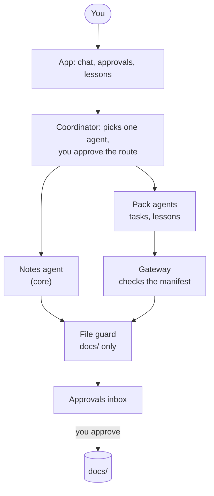
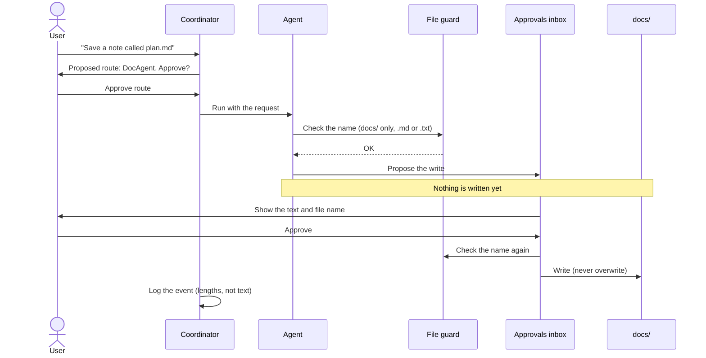
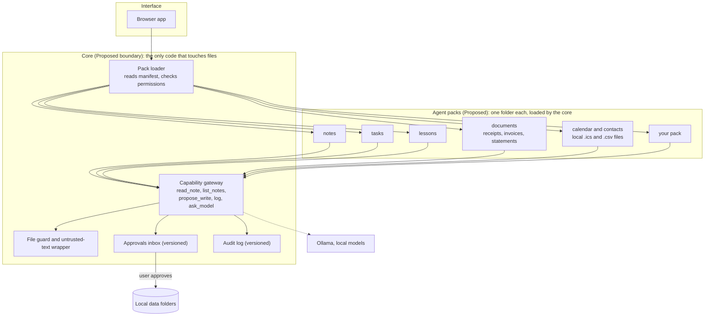
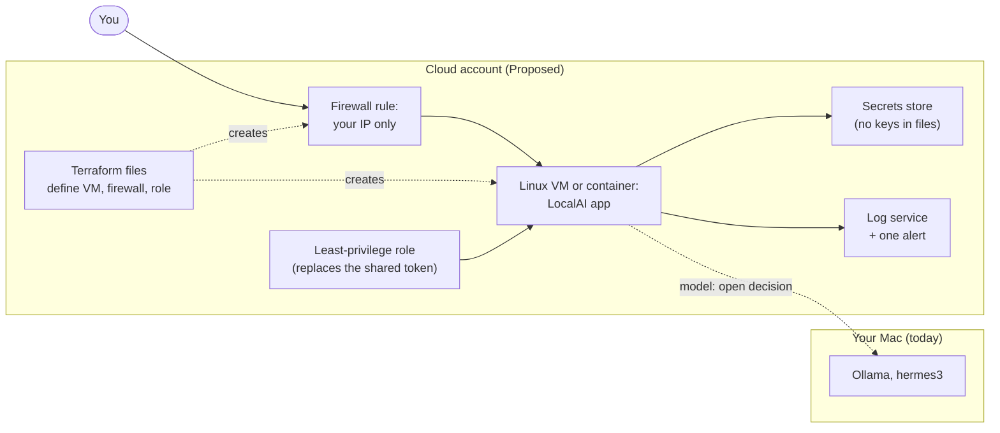
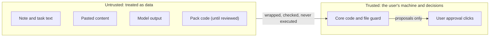

# LocalAI architecture

Written for: the project owner and future contributors, to see what exists, what is proposed, and why.
Rules: CLAUDE.md. Status of work and order: design/roadmap.md. Threat model: design/threat-model.md.
Items marked **Proposed** are not built. They need the owner's approval before work starts.

## The problem this solves

People hold private files (notes, tasks, receipts, statements, paperwork) that they cannot send to a
cloud model, and they cannot trust an agent that edits their files without asking.

LocalAI is a **safe way to let a small local model act on private data**:

1. Everything runs on the user's machine. No cloud model API, no telemetry.
2. The model can only *propose*. Nothing is written, moved, or deleted until the user approves.
3. Every action is logged, and the log does not store what the user typed.
4. Failures are measured with evals instead of assumed away.

The notes and tasks agents are the first examples, not the point. The point is the safe core that any
agent runs on.

## What exists today (built)



Where to look in the code:

| Part | File | What it does |
|---|---|---|
| Coordinator, routing, handoffs, activity log | `brain.py` | Model suggests one agent, the user approves; at most 2 steps per request |
| Notes agent | `agent.py` | `list_files`, `read_file`, `save_note`, `search_docs`; `_safe_path` is the file guard |
| Tasks pack | `packs/tasks/`, `task_agent.py` | `list_tasks`, `add_task`, `complete_task`; the prompt and tools live in the pack |
| Lessons pack | `packs/lessons/`, `lessons_agent.py`, `lessons.py` | `save_lesson`, `find_lessons`; the search ranking is in `lessons.py` |
| Pack gateway | `packs_gateway.py` | The only way a pack reaches files, the inbox or the log; checks the manifest first |
| Manifest checks | `packs_manifest.py` | Refuses unknown keys, bad names and bad permissions |
| Pack loader | `packs_registry.py` | Loads every pack at startup; a bad pack shows a warning and the others still load |
| Code review | `code_agent.py` | Read-only allowlist; the model's review is hints only |
| Approvals inbox | `pending_store.py` | Pending writes saved to `logs/pending_writes.json` |
| Safety helpers | `safety.py` | Name checks, `wrap_untrusted`, link and image cleanup |
| Evals and tests | `evals/`, `tests/` | Routing, tool choice, handoff, recall, injection, held-out review |

## The life of a write (the rule every agent follows)



Two approvals, two name checks. The model never writes.

## Where the project is going (Proposed)

The aim: a **connected local system** that other people can improve, without weakening the safety core.



### How a pack would be described

Each pack is a folder with a manifest. The manifest is what the core reads. A pack cannot do anything
the manifest does not declare.

```toml
# packs/documents/manifest.toml (Proposed example)
name = "documents"
version = "0.1.0"
api_version = 1                 # which core interface the pack was written for
purpose = "Organize receipts and invoices: extract fields and propose renames."   # shown to the router
tools = ["list_documents", "extract_fields", "propose_rename"]

[permissions]
read = ["docs/inbox/*.pdf", "docs/inbox/*.csv"]    # folders and kinds it may read
propose_writes = true                              # goes to the approvals inbox, never direct
model = true                                       # may call the local model
network = false                                    # always false in this project
```

### Rules that make packs safe (Proposed)

1. **Packs never open files.** They call the gateway, which applies the file guard.
2. **Packs never write.** They propose to the approvals inbox. The user approves.
3. **Every pack passes the same contract tests**: path escape, symlink, hard link, prompt injection,
   write needs approval. A pack that fails cannot be merged.
4. **No network access, no shell.** A manifest cannot ask for them.
5. **File text is data.** The core wraps it before any model sees it.
6. **The model decides, code copies.** Numbers and text come from code, not from the model.

### Updates and contributions (Proposed)

| Topic | Approach | Why |
|---|---|---|
| Who can add a pack | Packs live in the repo and are reviewed through pull requests | No unknown code runs on a user's machine. Installable third-party packs need a sandbox first and come later |
| How users upgrade | They pull a tagged release themselves and the app checks its hash. No background auto-update | Keeps "no telemetry, no surprise network calls" |
| Saved data across upgrades | A schema version in the approvals file and logs, with migrations | An upgrade must not break pending items |
| Versions | Semantic versioning; packs declare the core `api_version` they support | A pack and the core can change independently |
| Quality gate | CI runs lint, the contract tests, and the injection eval on every pull request | Daily contributions stay safe |

### Connected, still local

"Connected" means more local connectors (notes, tasks, a calendar file, exported statements) whose
results can be handed from one pack to another through the existing handoff step. Everything stays on
one machine.

Several people or devices sharing one server is a **separate, later phase**. It breaks a current rule
(no login, port bound to `127.0.0.1`), so it needs a login, per-user data, encrypted connections, and
a new threat model first.

## Cloud next steps (Proposed, not built)

Goal: run LocalAI on a cloud server you control, with the access and logging a cloud job needs. Each step
needs your approval, sets a monthly budget alert first, and has a tear-down step so nothing keeps billing.



| Step | What it does | Approval | Done when |
|---|---|---|---|
| C.1 | Run LocalAI on a Linux VM you control, with a note of which ports are open and why | Yes | The app runs there, and the port list is written down |
| C.2 | Deploy the container to one cloud VM, with a firewall rule that allows only your IP | Yes | Only your IP reaches the app; a test from another IP fails |
| C.3 | Define that VM and its firewall in Terraform; read `terraform plan` before every apply | Yes | Rebuilding from the files gives the same setup |
| C.4 | Send the activity log to the cloud's log service, with one alert (for example a blocked action) | Yes | The alert fires on a test event |
| C.5 | Replace the shared GitHub token with a least-privilege role; prove the old token no longer works | Yes | The old token is refused, and the new role can still push |

**Open decision (owner):** where the model runs. On the cloud VM means paying for a GPU and sending your
notes to a cloud machine. On your Mac means the VM needs a secure tunnel back to Ollama. Neither is built,
and the choice changes the privacy and cost picture, so it needs a decision before C.2.

**Rules for every cloud step:** a monthly budget alert before anything else; a tear-down step written
before the resources are created; no secrets in files or in the repository; and the threat model is
updated when the app stops being local-only.

## Trust boundaries



Details and known gaps: design/threat-model.md.

## How this is checked

| Claim | Evidence | Status |
|---|---|---|
| The model cannot write without approval | `tests/test_pending.py`, `tests/test_tasks.py`, `tests/test_integration.py` | Tested |
| File tools stay inside `docs/` | `tests/test_security.py` (path, symlink, hard link) | Tested |
| Hostile note text does not trigger a write | `evals/run_injection_evals.py` | hermes3 only: 12 of 12 held, 9 of those reached the model |
| Handoffs copy data faithfully | `evals/run_handoff_evals.py` | 5 of 5, no model |
| The code review finds real bugs | `evals/run_review_real.py`, `evals/run_heldout_review.py` | **No.** 0 of 3 and 1 of 6, so it is hints only |
| Packs follow the contract | Contract tests | **Proposed, not built** |

## Reading order for a new contributor

1. This file.
2. `design/threat-model.md` for what is guarded and what is not.
3. `design/roadmap.md` for the order of work and the progress log.
4. `design/brain.md` for the coordinator details.
