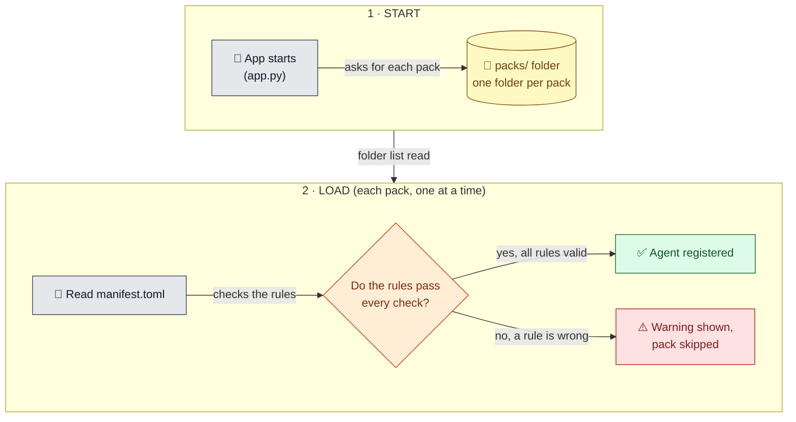
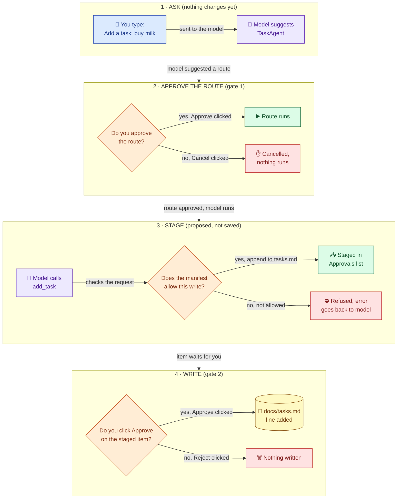
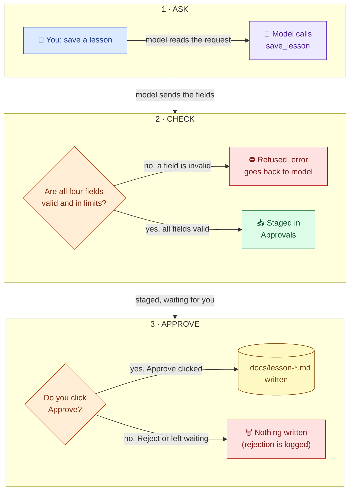
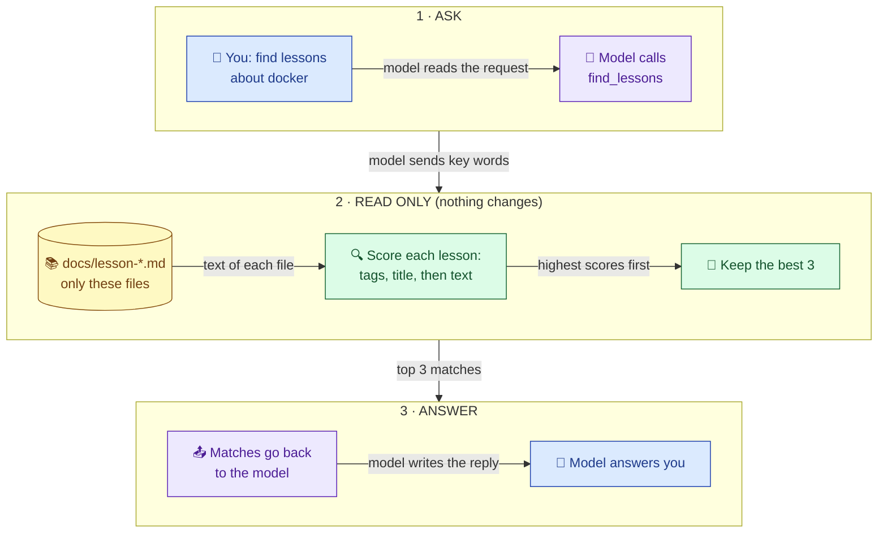
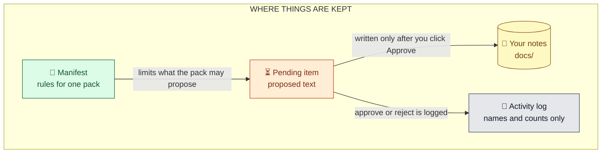
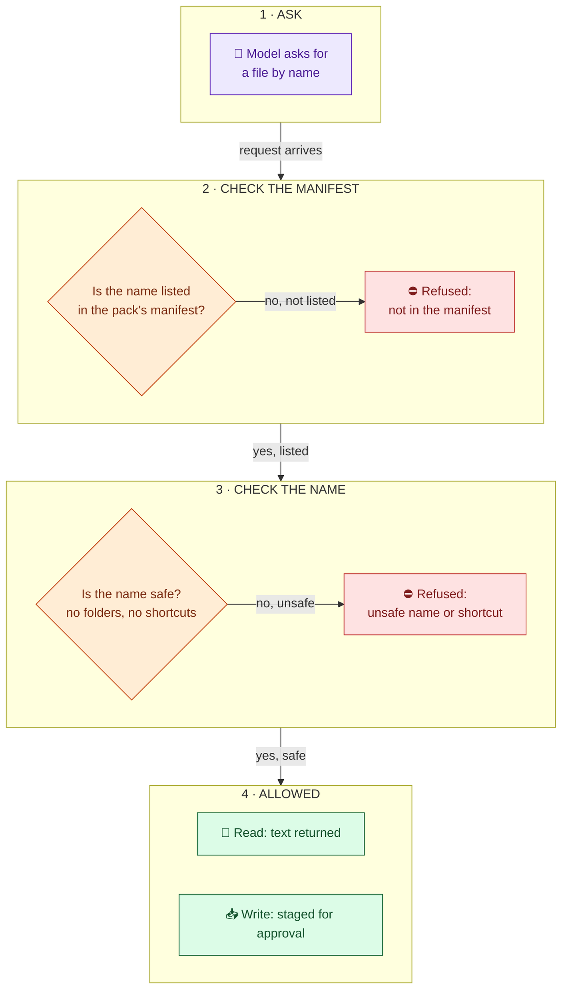

# Codebase map

Written for: the project owner, to learn the codebase by reading diagrams.

## How to read these charts

- **Read top to bottom.** Each coloured band is one stage, in order.
- **Inside a band, read left to right** for the steps that happen together.
- **Every arrow has a label** that says what passes along it.
- **Every decision is a question** (a box with a `{ }` shape). Each branch is labeled in words.
- **Icons add meaning:** 💬 you, 🧠🔧 model, 📜 rules, 📥 waiting, 📝 your file, ⛔ refused, ✅ passed.

## Legend (colours)

| Colour | Means | Examples |
|---|---|---|
| Blue | You | Typing, clicking Approve |
| Grey | The app's core code | Startup, the rules reader, the activity log |
| Green | Packs and their agents | The tasks and lessons packs |
| Purple | The model | hermes3, which only suggests |
| Orange | A decision or approval gate | A check, or your Approve button |
| Yellow | Files on disk | `docs/`, the manifests |
| Red | Refused or cancelled | A request that was stopped |

## 1. Startup

**What it shows:** the app reads each pack's rules and registers the agents that pass.

**Key:** a *manifest* is a pack's rules file. A *registry* is the list of agents the coordinator can use.

## 2. One request: "Add a task: buy milk"

**What it shows:** the path of one request through four bands. Two gates stop it: the route approval and the write approval.

**Key:** a *route* is which agent handles the request. A *tool* is a function the model can call. *Staged* means waiting, not saved.

## 3. Lessons: save

## 4. Lessons: find

Finding only reads, so there's no approval step.

## 5. What the app keeps

## 6. File access

**What it shows:** how a file request is checked, and where it can be stopped.

**Key:** the *gateway* is the one code path packs use to reach files. A *shortcut* (symlink) is refused, because it can point outside `docs/`.

## Where the code is

| Chart | Start reading here |
|---|---|
| 1. Startup | `app.py`, then `packs_registry.py` |
| 2. One request | `brain.py` (routing), `packs/tasks/pack.py` (the tool), `agent.py` (`approve_write`) |
| 3. Lessons save | `packs/lessons/pack.py`, then `lessons.py` (`build_lesson`) |
| 4. Lessons find | `packs/lessons/pack.py`, then `lessons.py` (`search_entries`) |
| 5. What the app keeps | `packs/*/manifest.toml`, `pending_store.py`, `brain.py` (`ActivityLog`) |
| 6. File access | `packs_gateway.py`, then `agent.py` (`_safe_path`) |

Update a chart in the same change as the code it shows.
